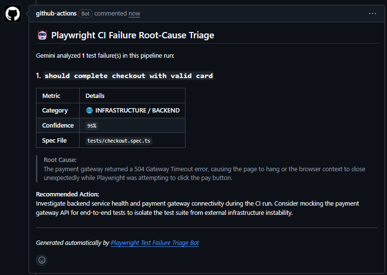

# 🤖 Playwright Test Failure Triage Bot (GitHub Action)

An AI-driven root-cause diagnostic GitHub Action that automatically triages failed Playwright test suites in CI/CD pipelines. Using Gemini Flash Lite, the bot categorizes failures (Flake, Regression, Selector Drift, Backend/Infrastructure), extracts contextual code snippets, and posts actionable triage reports directly to the Pull Request.

---

## 🎯 The Problem

When end-to-end test suites fail in CI/CD, developers often spend 15–30 minutes parsing thousands of lines of raw terminal logs and trace archives just to determine:
* Was this a legitimate application regression?
* Did an upstream backend/payment service throw a 504 timeout?
* Did a frontend component refactor break a locator?
* Was this an asynchronous race condition or network flake?

This action removes triage latency by delivering structured, senior-level SDET diagnostic reports straight to the PR discussion.

---

## 🏗️ How It Works

```text
[Playwright Test Step Fails]
             │
             ▼
[Generate test-results.json Report]
             │
             ▼
[GitHub Action: action-test-failure-triage]
             │
             ├─► Parses failure suites, stack traces, and code snippets
             │
             ├─► Evaluates failure heuristics against Gemini Flash Lite
             │
             └─► Formats & posts/updates PR comment (Zero-spam single comment thread)
```


### Supported Classifications

* 🚨 **`APPLICATION_BUG`**: Direct assertion mismatches and core business logic regressions.
* 🌐 **`INFRASTRUCTURE_OR_BACKEND_FAILURE`**: 5xx gateway errors, database timeouts, and upstream API crashes.
* 🔍 **`SELECTOR_DRIFT`**: DOM element modifications, missing locators, and UI refactors.
* ⚠️ **`FLAKE_OR_RACE_CONDITION`**: Non-deterministic execution order, animation delays, and timeout slips.
* ⚙️ **`ENVIRONMENT_MISCONFIGURATION`**: Missing environment variables, auth secret failures, or network routing issues.

---

## 🚀 Usage

Add this step to your GitHub Actions workflow file (e.g., `.github/workflows/e2e.yml`) immediately following your Playwright test run:

```yaml
name: E2E Pipeline

on:
  pull_request:
    branches: [ main ]

jobs:
  test:
    runs-on: ubuntu-latest
    permissions:
      contents: read
      pull-requests: write
      issues: write

    steps:
      - name: Checkout Code
        uses: actions/checkout@v4

      - name: Setup Node.js
        uses: actions/setup-node@v4
        with:
          node-version: 20

      - name: Install Dependencies
        run: npm ci

      - name: Run Playwright Tests
        run: npx playwright test --reporter=json:test-results.json
        # Ensure report step runs even if the tests fail
        continue-on-error: true

      - name: Triage Test Failures with Gemini
        if: failure() || steps.test.outcome == 'failure'
        uses: AhmedHoussou/action-test-failure-triage@v1
        with:
          github-token: ${{ secrets.GITHUB_TOKEN }}
          gemini-api-key: ${{ secrets.GEMINI_API_KEY }}
          report-path: 'test-results.json'
```

---

## ⚙️ Inputs

| Input | Required | Default | Description |
| :--- | :---: | :--- | :--- |
| `github-token` | **Yes** | `N/A` | GitHub token for posting PR comments (`${{ secrets.GITHUB_TOKEN }}`). |
| `gemini-api-key` | **Yes** | `N/A` | Google Gemini API Key used for log inference (`${{ secrets.GEMINI_API_KEY }}`). |
| `report-path` | No | `'test-results.json'` | Relative path to the Playwright JSON output report. |

---

## 🛠️ Local Development & Testing

```bash
# Clone the repository
git clone [https://github.com/AhmedHoussou/action-test-failure-triage.git](https://github.com/AhmedHoussou/action-test-failure-triage.git)
cd action-test-failure-triage

# Install dependencies
npm install

# Test local dry-run against mock failures
npx tsx src/index.ts

# Build bundled standalone distribution
npm run build
```

---

## 📄 License

MIT